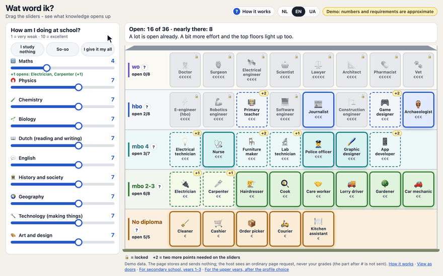

# Wat word ik?

A small web page for children from about age 10 (groep 7/8 and up) that shows
**why** to study and **what** to study. Drag the sliders for your school
subjects (1-10, the Dutch grade scale) and watch a building of 36 professions
light up or go dark. Click a profession to see what you need to know for it.



Try it: <https://ievgen-borysenko.github.io/wat-word-ik/>

It shows what is *open* with your grades, never what you *will become*.

**Status: M0 prototype with demo data.** All requirements, levels and pay
values are approximate and made up for this prototype; no source has been
used yet. See
[docs/methodology.md](docs/methodology.md) and [docs/sources.md](docs/sources.md).

Languages: Dutch, English, Ukrainian.

## Privacy

Static page, no backend. The page itself stores nothing and sends nothing: no
accounts, cookies, local storage, analytics, ads, external fonts or network
requests. The grades and the goal live only in the part of the address after
`#`. The hosting provider serves the files and sees an ordinary page request,
but never the grades: browsers do not send the part after `#`.

## Run

Requires Node.js and npm.

```sh
npm ci --ignore-scripts  # install exactly what package-lock.json lists, run no install scripts
npm run dev              # local dev server
npm test                 # unit tests (engine, data, translations, store, built CSP)
npm run typecheck
npm run build            # static site in dist/, works from any sub-path
```

## What CI checks

Every pull request and every push to `main` runs the same checks, so that we
ship the page and nothing else:

- the repository, and every commit of a pull request, holds only files on an
  explicit list; every tracked file is text without an e-mail address, a path
  from a developer's computer, a private key or a private network address,
  except the animation above. That one must be a looping GIF in one fixed
  form, at most 2 MiB and 880x880 pixels, in every commit that changes it:
  without the metadata that tools write (comments, XMP, colour profiles) and
  with nothing appended. The check cannot see data hidden on purpose in its
  pixels, its colour table or the fields the format leaves free; the reviewer
  looks at the animation;
- secret scan of the whole git history and of the built site;
- dependencies only from the npm registry, with integrity hashes and
  permissive licences; no known high or critical vulnerabilities at run time;
- commits carry only GitHub noreply addresses, no trailers but the
  maintainer's co-author line and Dependabot's sign-off, and no generated-by
  footers;
- the built site is audited in a separate job that installs no dependencies,
  so no package code can touch the audit: it holds only the page and its
  bundles, stays within a size budget, contains no local paths, private
  addresses, e-mail addresses or keys, uses no browser feature that sends or
  stores data and no way to send data to its own host, keeps a
  Content-Security-Policy that lets the page load its own script and
  stylesheet and nothing else, and carries the licence notice of every
  package bundled into it;
- end-to-end tests in Chromium on that same audited build: the browser asks
  only for the page and its own files, never with a query string, nothing is
  stored, no console errors, no serious accessibility findings, and the
  layout fits desktop and phone screens.

Only then, and only from `main`, is that exact build deployed to GitHub Pages.
Details: [docs/ci.md](docs/ci.md). To report a problem: [SECURITY.md](SECURITY.md).

```sh
npm run check:tree && npm run check:lock && npm run check:links
npm run build && npm run check:dist
npx playwright install chromium   # once
npm run e2e                       # end-to-end tests of dist/
```

## Layout

```
src/engine   pure TypeScript: scoring, hints, URL hash codec (+ tests)
src/data     subjects and professions (demo data, 3 languages) + validation test
src/i18n     UI strings: nl.json, en.json, ua.json
src/ui       Preact components
docs         methodology, sources, how to contribute, what CI checks, demo.gif
scripts      CI checks: files, lockfile, commits, links, built site (+ tests);
             record-demo.mjs, which records docs/demo.gif (not run in CI)
e2e          end-to-end tests of the built site (Playwright)
.github      CI workflow and Dependabot settings
```

## Licence

MIT, see [LICENSE](LICENSE). The built page bundles Preact and Preact Signals
(MIT); their copyright and licence notices open the built script.
